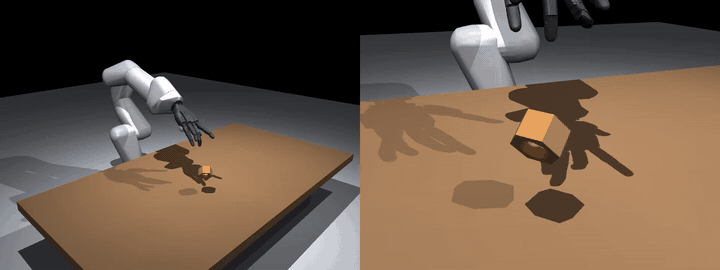
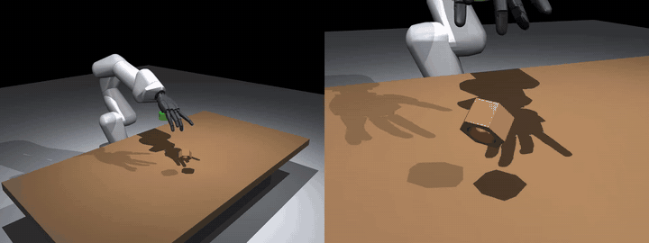
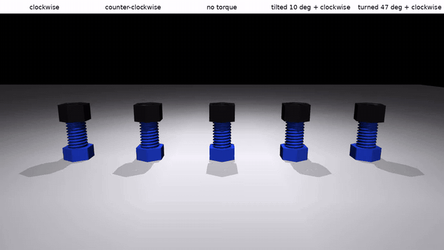
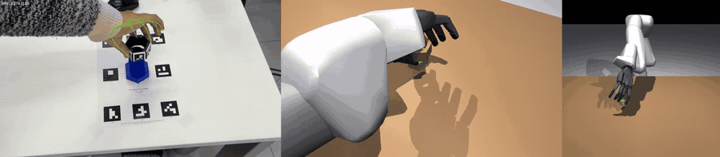
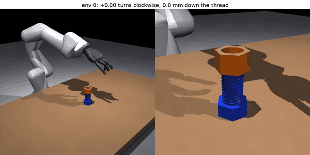
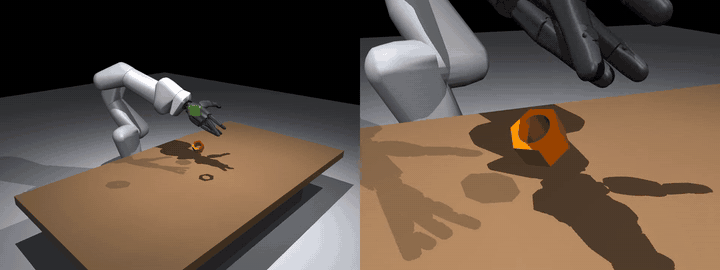
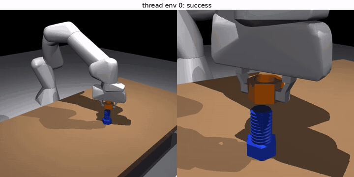
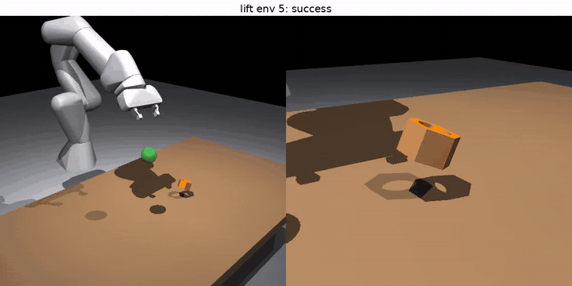

# Nut assembly: from a phone video to a Franka + Sharpa hand screwing a nut

A second, harder task in the same spirit as the cube: a 3D-printed nut and bolt, filmed with a phone (RGB only),
a simulated Franka arm with a Sharpa Wave hand, reinforcement learning in Isaac Lab, and SmolVLA trained from the
RL policies.

**Where the idea came from.** This is what I wanted to try — SimToolReal, from the authors' repository
([simtoolreal.github.io](https://simtoolreal.github.io/), video from
[tylerlum/simtoolreal](https://github.com/tylerlum/simtoolreal)):

https://github.com/user-attachments/assets/e2d0db98-2e31-46aa-9480-c4c6f4a48f7d

This project started from SimToolReal (Lum et al. 2026): one RL policy, trained in
simulation, that brings an object to any goal pose, so that a task can be given as a sequence of goal poses taken from
a video of a person doing it. SimToolReal records that video with an RGB-D camera and tracks the object with
FoundationPose; I wanted to do the same with an ordinary phone video (RGB only) and with my own robot set-up (Franka +
Sharpa hand instead of their KUKA + Sharpa hand). I took its reward design and observation layout as the base, and
then followed the same group's Play2Perfect for the assembly part: pre-train the goal-pose policy, then fine-tune it
on screwing with goals a quarter turn apart.

**Short version.**

- **What worked.** RL learns to pick the nut up from any resting pose and carry it to a goal (93 % under full gravity),
  and to turn it to a goal orientation (66 % of goals within 3 cm and 30°). The thread works in simulation: turning the
  nut screws it down one pitch per turn. From the RGB phone video alone I get the camera calibration, the nut's 6D
  trajectory and my hand's motion retargeted onto the robot.
- **With a parallel gripper instead of the hand**, the same nut and bolt: RL threads the nut onto the bolt in 128 of 128
  episodes (Factory's criterion: the thread has caught, about half a turn), and picks it up and brings it to a goal in
  19 %.
- **What did not.** Screwing with the dexterous hand: each reward I tried was first exploited (pushing the nut down
  through the thread, knocking it off the bolt); with the arm's force capped below what the thread holds, the policy
  no longer cheats but does not turn the nut either. SmolVLA students trained from the RL teacher pick the nut up in
  5–9 % of episodes (teacher: 96 %), the best after four rounds of DAgger.

| picking up (RL, 93 %) | turning to a goal orientation (RL) |
|---|---|
|  |  |

*Orange: the nut (black in reality, recoloured so it stands out from the hand). Green: the goal.*

## The parts

| | measured | model |
|---|---|---|
| nut | 51 mm across flats, 33 mm thick | [`nut_geometry.py`](franka_sharpa/nut_geometry.py), 35 g |
| bolt | 38 mm thread, 6 mm pitch, about 85 mm long | [`thread_geometry.py`](franka_sharpa/thread_geometry.py), ISO 60° profile, right-handed |

There is no STL of the print, so both are rebuilt from tape-measure readings. For picking up, the nut is 12 convex
pieces; for screwing, nut and bolt get real threads as SDF collision meshes, as in Play2Perfect's screwing task.

**Does the thread work?** Spinning the nut on the bolt with a torque, no robot
([`test_thread_physics.py`](scripts/test_thread_physics.py)):



| radial clearance | clockwise, 3.7 turns | started 10° tilted |
|---|---|---|
| 0.5 mm | 17.7 mm down | slides off the bolt |
| **1.0 mm** | **21.4 mm down** (6 mm pitch → 21.9) | **self-aligns, 21.3 mm down** |

Counter-clockwise unscrews it, no torque leaves it resting on the tip. 1 mm is used from here on.

## Demonstrations from RGB video

25 clips of me picking the nut up and screwing it onto the bolt, from a fixed iPhone, no depth.

- **Markers instead of depth.** SimToolReal tracks the object with FoundationPose on RGB-D. Here: ArUco markers on the
  six side faces of the nut and a marker board under the bolt ([`make_markers.py`](scripts/make_markers.py)).
- **Camera from the clips themselves** ([`track_nut.py`](scripts/track_nut.py)): one bundle adjustment over the board
  and 400 frames of the nut finds the focal length (1754 px), the board pose and how far each hand-cut label sits off
  its face (up to 4 mm). Reprojection error 0.5 px on the board, 2.1 px on the nut.
- **Nut pose** in every frame with a marker (25–70 % of frames; the hand hides the rest). The direction of screwing
  comes out of the video: clockwise, seen from above, in 6 of the 7 clips with more than one tracked turn.
- **Hand → robot** ([`retarget_mano.py`](scripts/retarget_mano.py)): MANO hand tracking (WiLoR, as for the cube),
  the 21 keypoints placed in 3D with the calibrated camera, the Sharpa fingers fitted to the fingertips and the Franka
  arm to the palm by inverse kinematics. 19 of 25 clips are usable: palm within 2.3 mm / 3.3° of my hand. The robot
  hand is 1.3× larger than mine, so its fingertips stay about 1 cm short of the nut.



## Reinforcement learning (Isaac Lab, Franka + Sharpa Wave)

Built on Isaac Lab's Dexsuite task (Allegro hand in the original), with the Kuka arm and Allegro hand replaced by the
Franka and the Sharpa Wave hand ([`robot.py`](franka_sharpa/robot.py), [`build_robot.py`](scripts/build_robot.py)).

### Stage 0: pick up and carry (position goals)

| rewards | result (1024 episodes, full gravity, nut at rest on the table) |
|---|---|
| dense distance terms, paid only while thumb and a finger hold the nut | **lifted and held 92.6 %, at the goal (5 cm) 93.0 %**, median goal error 8 mm |
| SimToolReal's progress rewards + Dexsuite's action penalties | learned to keep still |
| SimToolReal's progress rewards alone | barely lifts in 2000 iterations |

The nut starts dropped from up to 40 cm with a random orientation, so it lies flat or on its side; both are picked up
(lifted: 93.2 % / 92.0 % for the smaller / larger half of the size randomisation).

### Stage 1: turn it (6D goals), after Play2Perfect's play stage

Goals now include orientation and change every 2–3 s, continued from the stage-0 policy. The first try ignored the
orientation completely (median error 170°): a hex nut looks the same turned by 60° or upside down, but the reward asked
for one particular face up, which would take an in-hand flip. Measuring the error up to the nut's 12 symmetries fixed it:

| | median orientation error | goals reached (3 cm, 30°) | lifted and held |
|---|---|---|---|
| plain orientation error | 170° | 0 % | 91 % |
| **symmetric error** | **24°** | **66 %** | **96 %** |

### Stage 2: screw it onto the bolt, after Play2Perfect's screwing task

The nut starts on the bolt tip; the goal is a chain of waypoints a quarter turn clockwise and a quarter pitch lower
each ([`screw.py`](franka_sharpa/tasks/nut_lift/screw.py)), continued from the stage-1 policy.

| reward | what the policy learned |
|---|---|
| depth down the thread | **pushed the nut 17 mm down with 0.02 turns**: the arm forces it through the SDF thread |
| depth only as far as the rotation explains it, penalty for the rest | no signal: the first ~0.7 turn catches the thread without going down |
| + one turn credited without descent | still pushes; then |
| + penalty for knocking the nut off | nut stays on the bolt (92 %), still pushed down 16 mm with 0.01 turns |
| + large reward on the nut's clockwise spin, grasp not required | no spin within the last 30 minutes of training |



Episodes reaching the time limit fell from 33 % to 4 % within 30 minutes in the third run: knocking the nut off the
bolt ends the episode, and with it the penalty. Each fix closed one shortcut, but the root cause is physical: the
Franka can press the nut through the SDF thread contact, so pressing is easier than turning. The stage-1 policy, which
never trained on the bolt, does the same when given the screwing waypoints (26 mm down, 0.06 turns).

**How hard can the nut be pushed before the thread gives way?** A constant downward force on the nut resting on the
tip, no torque, 3 s ([`test_thread_push.py`](scripts/test_thread_push.py)):

| radial clearance | ≤ 20 N | 50 N | 100 N | 200 N |
|---|---|---|---|---|
| 0.5 mm | holds | holds | holds | 13.6 mm down |
| **1.0 mm** | holds | holds | holds | 11.9 mm down |
| 1.5 mm | holds | 5.3 mm down | 11.2 mm down | 11.6 mm down |

The thread holds up to 100 N; the Franka (87 Nm joints) presses far harder. A looser thread would make it worse. With
the arm's joint torques capped (20 Nm for joints 1–4, 6 Nm for 5–7; the arm carries no gravity in this simulation) and
1500 more iterations from the stage-1 policy: the nut no longer goes down without turning (0 mm), but it does not turn
either (0.00 turns), so the hand still has to discover turning on its own.

## SmolVLA from the RL teacher

The teacher sees the nut and the goal as numbers; SmolVLA sees camera images (MuJoCo replays of Isaac states, since
Isaac's renderer crashes on this machine) and the joint angles, and outputs joint targets. Closed-loop evaluation runs
the student alone in Isaac ([`eval_vla_closed_loop.py`](scripts/eval_vla_closed_loop.py), policy server
[`vla_server.py`](scripts/vla_server.py)).

**One camera, lift task, 64 episodes:**

| trained on | lifted and held |
|---|---|
| nothing (smolvla_base) | 0 % |
| my 19 retargeted human clips | 0 % |
| 131 teacher episodes | 1.6 % |
| both | 0 % |

The students move the hand towards the goal marker but do not close it on the nut: in a 256 px view from across the
table the nut is about 10 px wide.

**Two cameras (overview + palm), stage-1 task (position and orientation goals), 380 teacher episodes:**

| policy | goals reached (3 cm, 30°) | lifted and held |
|---|---|---|
| RL teacher (sees the state) | 66 % | 96 % |
| SmolVLA, teacher data, overview + palm camera | 0 % | **4.7 %** |
| SmolVLA, teacher data, overview camera only | 0 % | 0 %\* |
| SmolVLA, teacher data + my 19 retargeted clips, overview + palm camera (399 episodes) | 0 % | 0 %\* |
| SmolVLA, my 19 retargeted clips only, overview + palm camera | 0 % | 0 %\* |

**Correction.** The closed-loop evaluation first clipped the student's actions to ±1 (in units of the action scale),
while the teacher's are not clipped: 60 % of the teacher's actions exceed 1, up to 22. Without the clip, the
two-camera student lifts the nut in 4.7 % instead of 0 %. Rows marked \* (and the one-camera table above) were
measured with the clip and not re-run.

**DAgger** ([`dagger_loop.sh`](scripts/dagger_loop.sh), [`dagger_rollout.py`](scripts/dagger_rollout.py)): each round
the current student drives 128 episodes (the teacher's action is executed instead with probability β), the RL teacher
labels every state the student visits, all data so far is merged, the student is fine-tuned, then evaluated alone
(64 episodes):

| round | β | data | student alone: lifted and held | goals reached |
|---|---|---|---|---|
| 0 | – | 380 episodes | 4.7 % | 0 % |
| 1 | 0.5 | 507 | 4.7 % | 0 % |
| 2 | 0.3 | 634 | 6.2 % | 0 % |
| 3 | 0.15 | 761 | 7.8 % | 0 % |
| 4 | 0 | 888 | **9.4 %** | 0 % |

Every round helps a little; the student is still far from the teacher.



In closed loop most students reach towards the goal marker without picking the nut up; offline, on held-out teacher
episodes, the one-camera student's hand actions are twice as close to the teacher's as "keep still" (0.32 vs 0.66 rad
mean error), its arm actions no better (0.16 vs 0.16). Imitating a 29-joint policy from a few hundred demonstrations
does not survive its own small errors; DAgger closes the gap only slowly.

## The same nut with a parallel gripper

To separate "the task is hard" from "the hand is hard", the same nut and bolt with the Franka's own parallel gripper
([`gripper_nut/`](franka_sharpa/tasks/gripper_nut)):

| task | based on | result |
|---|---|---|
| pick the nut up from the table (flat or on its side), bring it to a goal | Isaac Lab's Franka lift task | 18.9 % within 5 cm of the goal (512 episodes, median error 79 mm) |
| thread the nut onto the bolt, starting held above the bolt | Isaac Lab's Factory NutThread, with M38 parts | **128 / 128** |

| gripper: threading (RL) | gripper: picking up (RL) |
|---|---|
|  |  |

The threading success is Factory's criterion: the nut is centred on the bolt and has gone down past a fraction of a
pitch below where the thread catches. Measured from the poses: the nut starts 14–24 mm above the bolt tip, is lowered
onto it, turned 0.43 turns clockwise (about 155°, the most Factory's controller turns in a 30 s episode) and ends
7.3–7.8 mm below the tip — seated on the tip's chamfer and 2.6 mm (0.43 × 6 mm) along the thread. So the gripper
policy really screws the nut on, but only starts it: tightening it fully would take several more turns with regrasps.
Factory's own yaw window for the bolt (120–150°) never let the thread catch with this nut's countersink; the window
was moved to where a geometric model of the seat says the thread catches (299–329°), and a scripted turn then threaded
30 of 32 nuts before training.

The training sets are on the Hugging Face Hub as LeRobot datasets:
[Kaz55/nut_rl_distill_2cam](https://huggingface.co/datasets/Kaz55/nut_rl_distill_2cam) (380 teacher episodes),
[Kaz55/nut_human_mano_2cam](https://huggingface.co/datasets/Kaz55/nut_human_mano_2cam) (19 retargeted clips),
[Kaz55/nut_mix_2cam](https://huggingface.co/datasets/Kaz55/nut_mix_2cam) (both).

## What did not work

- SimToolReal's progress rewards with Dexsuite's action penalties: the policy keeps still. Without them: too sparse
  for the time I had.
- Full random orientation goals straight from the lift policy: the grasp collapsed in 30 iterations (half the episodes
  ended by the joint-velocity safety stop).
- Screwing: see stage 2. Pushing through the thread and knocking the nut off were both found from the logs (turns vs.
  descent, episode endings), not from the reward curve, which looked good in both cases.
- SmolVLA from the hand teacher: 4.7 % lifted, 9.4 % after four DAgger rounds; no 6D goal reached.
- Screwing with the hand under a force cap: no cheating, but no turning.

## Next

- Hand screwing: keep the force cap and start from the nut already held (as Factory does for the gripper), so turning
  is the only thing left to learn.
- SmolVLA: distil the gripper policies first (8 joints instead of 29, closer to SmolVLA's pre-training); more DAgger
  rounds for the hand; then, once a screwing teacher exists, a language-conditioned student that repeats "turn the nut
  a little" until it is tight, with the goals still taken from the phone video.

## Run it

```bash
python scripts/build_nut.py && python scripts/build_threaded.py             # USD assets
python scripts/test_thread_physics.py --headless                            # thread physics
python scripts/train.py --task Franka-Sharpa-Nut-Lift-Dense-v0 --headless   # stage 0
python scripts/train.py --task Franka-Sharpa-Nut-Play-v0 --headless --resume --load_run <run> --checkpoint <ckpt>  # stage 1
python scripts/train.py --task Franka-Sharpa-Nut-Screw-v0 --headless --resume --load_run <run> --checkpoint <ckpt> # stage 2
python scripts/evaluate.py / evaluate_screw.py ...                           # metrics + trajectories for the videos
```

Gripper: `python scripts/train.py --task Franka-Gripper-Nut-Lift-v0 --headless` and
`python scripts/train_rl_games.py --task Franka-Gripper-Nut-Thread-v0 --headless`, evaluated with `evaluate_gripper.py`.
DAgger: `scripts/dagger_loop.sh <student checkpoint> 4`. Thread push test: `test_thread_push.py`.

Video side: `detect_markers.py` → `track_nut.py` → `retarget_mano.py` → `build_human_dataset.py`;
teacher side: `evaluate.py` (record) → `build_distill_dataset.py` → `lerobot-train` → `eval_vla_closed_loop.py`.

## Credits

SimToolReal (Lum et al. 2026, github.com/tylerlum/simtoolreal) and Play2Perfect (Lum, Kedia, Liu, Bohg 2026,
github.com/kushal2000/play2perfect) for the method; Isaac Lab's Dexsuite task; the Sharpa Wave URDF
(github.com/sharpa-robotics/sharpa-urdf-usd-xml, Apache-2.0); MANO and WiLoR for hand tracking; LeRobot and SmolVLA.
